# Design: Public APIM ingress with JWT validation and private backends

| | |
|---|---|
| **Audience** | Architecture Board, Security Board |
| **Status** | Draft for review |
| **Decision requested** | Approve pattern 3.2 ("public APIM ingress with JWT validation and private backends") as the target architecture for the SPFx chat API. Also decide on the open items in [section 13](#13-decisions-requested-from-the-board). |
| **Based on** | [Research: APIM with JWT validation and private backends](../research/private-backend-teams-sharepoint.md) (2026-11-04) |
| **Identifiers** | All tenant IDs, client IDs and resource names in this document are placeholders, such as `<tenant-id>`, `<api-client-id>` and `<apim-name>`. |

> Items marked **[verify]** are not confirmed by official documentation or by a test in our environment. They are covered by the proof of concept (PoC) and the validation plan in [section 12](#12-validation-plan-and-acceptance-criteria).

---

## 1. Summary

The chat web part runs in SharePoint Online and Microsoft Teams. It calls an ASP.NET Core API that answers questions using Azure AI Search and Azure AI Foundry (Azure OpenAI) and streams the answer back as Server-Sent Events (SSE).

The API is currently reachable from the internet. This design moves it behind **Azure API Management (APIM)**:

- **APIM is the only public entry point.** It is deliberately reachable from the internet. It validates the user's Microsoft Entra ID access token and the delegated scope `access_as_user`. Requests that fail are rejected before they reach any backend.
- **The API (App Service) has public network access disabled.** It can only be reached through a private endpoint. APIM reaches it over a private network path through outbound VNet integration.
- **The API keeps its own token validation** (defence in depth). APIM forwards the user's bearer token unchanged.
- **AI Search and Azure AI Foundry become private too.** The API reaches them through private endpoints. AI Search reaches the embedding model through a shared private link. All services have public network access disabled.

Users need no VPN, Entra Private Access or private DNS. Any device that can open SharePoint or Teams can use the chat, as long as it has a valid token. That is the main reason to prefer this pattern over private APIM ingress (pattern 3.1).

**What this pattern is not:** it is not "no public endpoint". A public endpoint (APIM) exists by design. The security argument is that this endpoint is narrow, authenticated, authorized, rate-limited and monitored, and that every backend is private.

## 2. Context and scope

### 2.1 Current state

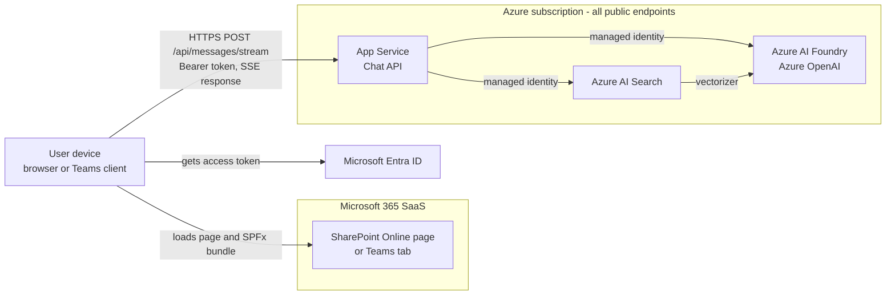

Current controls, taken from the repository:

| Control | Where |
|---|---|
| Entra ID JWT validation (`Microsoft.Identity.Web`) and policy `AccessAsUser`, which requires scope `access_as_user` on every controller | [Program.cs](../../api/Program.cs) |
| CORS with an exact list of allowed origins (SharePoint tenant, Teams, local workbench) | [Program.cs](../../api/Program.cs), [appsettings.json](../../api/appsettings.json) |
| System-assigned managed identity to Search and Foundry; no keys in configuration | [Program.cs](../../api/Program.cs) |
| Generic error message with a trace reference. Exception details are not streamed to the client. | [MessagesController.cs](../../api/Controllers/MessagesController.cs) |
| IdentityModel PII logging only possible in Development, behind an explicit switch | [Program.cs](../../api/Program.cs) |

### 2.2 In scope

- Internet ingress through APIM, including JWT validation, scope authorization, CORS, rate limiting and SSE pass-through.
- Private connectivity from APIM to the API.
- Private connectivity from the API to AI Search and Azure AI Foundry, and from AI Search to Azure AI Foundry (pattern 3.3 in the research).
- Logging, monitoring and operations impact.

### 2.3 Out of scope

- The chat logic, prompt design and RAG quality.
- Index ingestion pipelines, apart from their network path.
- Private APIM ingress (pattern 3.1). It appears only as a rejected alternative in [section 14](#14-alternatives-considered).
- SKUs and costs. The APIM tier is an open board decision ([section 13](#13-decisions-requested-from-the-board)).

## 3. Requirements

### 3.1 Functional

| ID | Requirement |
|---|---|
| F1 | The SPFx web part works in SharePoint Online (browser), Teams desktop, Teams web and Teams mobile. |
| F2 | Answers stream token by token (SSE) through every hop. The first chunk arrives before the full answer is ready. |
| F3 | If the user cancels or closes the page, server-side work stops. |
| F4 | APIM is the single, stable entry point for this API and for future APIs, with consistent paths and versioning. |

### 3.2 Security

| ID | Requirement |
|---|---|
| S1 | No backend (API, Search, Foundry) is reachable from the public internet. |
| S2 | Every request to the API carries a valid delegated Entra ID token for our tenant, with the correct audience and scope `access_as_user`. APIM checks this before forwarding, and the API checks it again. |
| S3 | App-only tokens, tokens from other tenants and tokens for other audiences are rejected. |
| S4 | No secrets or APIM subscription keys are embedded in the SPFx bundle. Browser code cannot keep secrets. |
| S5 | Service-to-service authentication uses managed identities. Key-based (local) authentication on Search and Foundry is disabled. |
| S6 | Prompts and answers are not written to gateway or platform logs. Logs contain metadata only. |
| S7 | The public entry point is protected against abuse: rate limits per user and, optionally, a WAF/DDoS layer. |
| S8 | All traffic uses TLS 1.2 or later, including traffic on private network paths. |

### 3.3 Non-functional

| ID | Requirement |
|---|---|
| N1 | Streams survive idle gaps shorter than the intermediary idle limit (the documented Azure Load Balancer idle timeout is 4 minutes). |
| N2 | The design does not require any client-side network change (no VPN, private DNS or agent on the device). |
| N3 | Requests can be traced end to end through a correlation ID that is returned to the user in error messages. |

## 4. Target architecture

### 4.1 Logical view

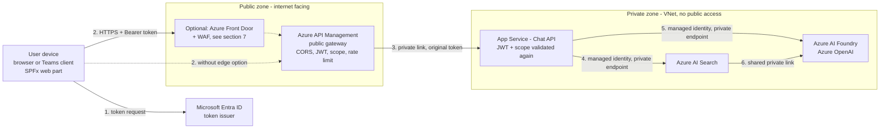

### 4.2 Network view

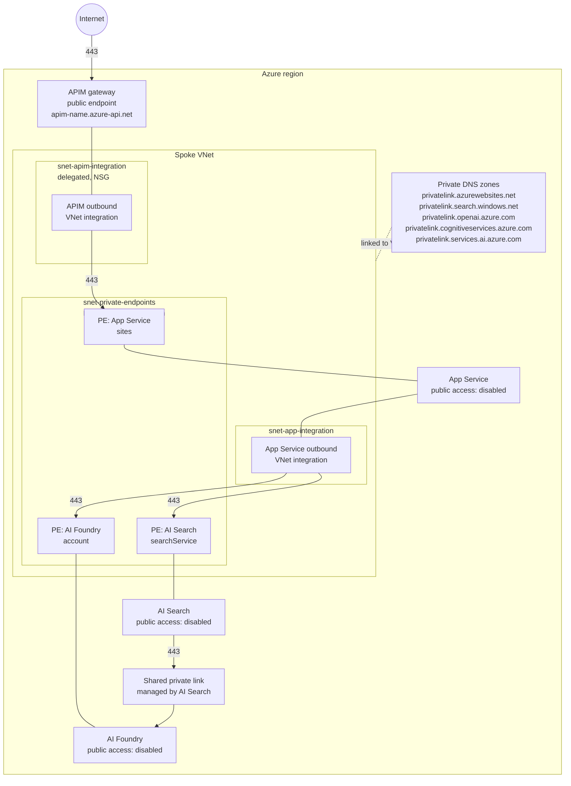

Network rules:

| From | To | Port | Allow | Notes |
|---|---|---|---|---|
| Internet | APIM gateway | 443 | Yes | The only internet-facing endpoint. With the edge option, only Front Door is allowed (see [section 7](#7-optional-edge-protection-front-door--waf)). |
| `snet-apim-integration` | PE App Service | 443 | Yes | The only allowed path to the API. |
| Anything else | PE App Service | any | **No** | NSG on `snet-private-endpoints`. Requires private endpoint network policies to be enabled on the subnet. |
| `snet-app-integration` | PE Search, PE Foundry | 443 | Yes | API to downstream services. |
| Internet | App Service, Search, Foundry | any | **No** | Public network access is disabled on each resource. |
| AI Search | AI Foundry | 443 | Yes | Through the shared private link only. The link must be approved on the Foundry resource. |

The exact private DNS zones for Azure AI Foundry depend on the resource type and the endpoints in use. Confirm them during the PoC **[verify]**.

### 4.3 Trust boundaries

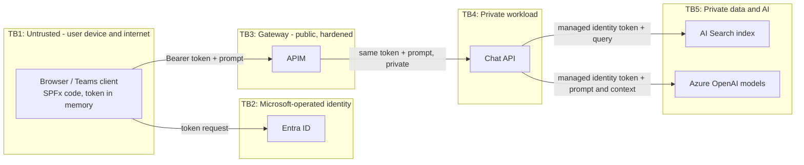

| Boundary | What crosses it | Main control |
|---|---|---|
| TB1 → TB2 | User sign-in and token request | Entra ID sign-in, Conditional Access, MFA |
| TB1 → TB3 | User access token, prompt | TLS, CORS, `validate-azure-ad-token`, scope check, rate limit, optional WAF |
| TB3 → TB4 | The same user access token, prompt | Private link, NSG, TLS, the API's own JWT and scope validation |
| TB4 → TB5 | Managed identity token, search query, prompt and retrieved context | Private endpoints, Entra RBAC, local authentication disabled |

## 5. Identity and authorization

### 5.1 Identities

| Identity | Type | Used for | Permissions |
|---|---|---|---|
| End user | Entra ID user | Signs in to SharePoint/Teams. Holds the delegated token. | Consent to `access_as_user` on the API app registration |
| SPFx client | First-party SharePoint client extensibility principal | Requests the token on behalf of the user (`AadTokenProvider` / `AadHttpClient`) | API permission `access_as_user`, approved in the SharePoint admin center |
| Chat API app registration (`<api-client-id>`) | App registration | Token audience. Exposes scope `access_as_user`. | None needed on Microsoft Graph for this flow |
| App Service managed identity | System-assigned | API → AI Search, API → Foundry | `Search Index Data Reader` on the index or service. A least-privilege Foundry/Azure OpenAI data-plane role, for example `Cognitive Services OpenAI User` |
| AI Search managed identity | System-assigned | Vectorizer → embedding model | Least-privilege Foundry/Azure OpenAI data-plane role on the embedding deployment's resource |
| APIM managed identity | System-assigned | Optional: Key Vault for certificates and named values | `Key Vault Secrets User` only if needed. **Not** used to call the API in this design. |

### 5.2 Token rules

| Claim | Required value | Enforced by |
|---|---|---|
| `iss` / `tid` | `<tenant-id>` only | APIM (`tenant-id`), API (`AzureAd:TenantId`) |
| `aud` | `<api-client-id>` (bare client ID; the API uses v2 access tokens) | APIM (`audiences`), API (`AzureAd:Audience`) |
| Signature, `exp`, `nbf` | Valid Entra ID signing key, within lifetime | APIM, API |
| `scp` | Contains `access_as_user`. Space-separated list. | APIM (separate 403 check), API (`RequireScope`) |
| `roles` without `scp` (app-only token) | Rejected | APIM (missing `scp` → 403), API |
| `azp` / `appid` | Optional: the SharePoint client extensibility principal of the tenant | APIM `client-application-ids`. **[verify]** the correct application ID before enforcing. |

The APIM hostname is **not** the token audience. The token is meant for the API, and APIM is a pass-through checkpoint. That keeps `apiResource` in the web part and the API's accepted audience unchanged.

### 5.3 Why APIM forwards the user's token rather than its own

- The API keeps enforcing the user's identity and scope. If APIM is misconfigured, the API still rejects bad tokens.
- No new trust relationship ("trust anything APIM sends") is needed.
- The API keeps user context (`oid`, `tid`) for auditing.

Trade-off: the token is visible to APIM and to the API. Both are inside our control boundary, and APIM does not log the `Authorization` header (see [section 9](#9-logging-monitoring-and-data-handling)).

### 5.4 Data authorization in the RAG step

The API calls AI Search with **its own managed identity**, not with the user's identity. Every authenticated user can therefore retrieve any content in the index. That is acceptable only if the index holds content that every user with the `access_as_user` permission may see. If not, the board should ask for per-user filtering (security trimming) as a separate design item. The ingress pattern does not change this.

## 6. Request flows

### 6.1 Sign-in and token acquisition

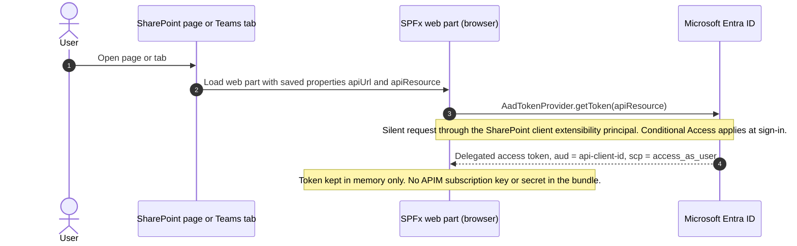

### 6.2 CORS preflight

The browser sends an `OPTIONS` preflight because the request is cross-origin and carries an `Authorization` header and a JSON body. APIM answers it itself, without requiring a token. APIM is the **single owner of CORS** at the gateway. The API's own CORS policy stays as a second layer.

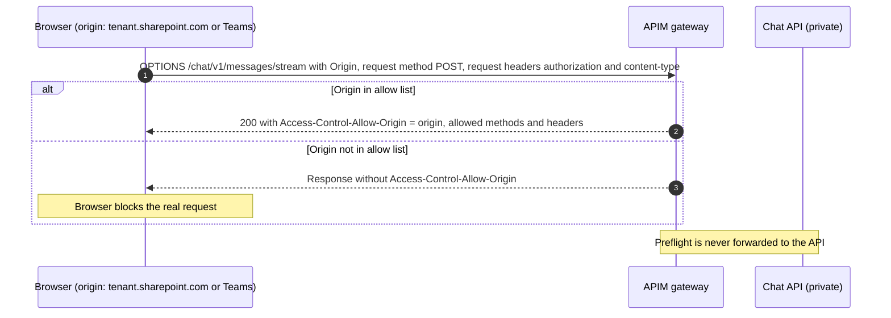

CORS does **not** authorize anything. It only decides whether the browser may read the response. A successful preflight does not let the following POST through. The POST must still pass token validation.

### 6.3 Authorized streaming chat request (happy path)

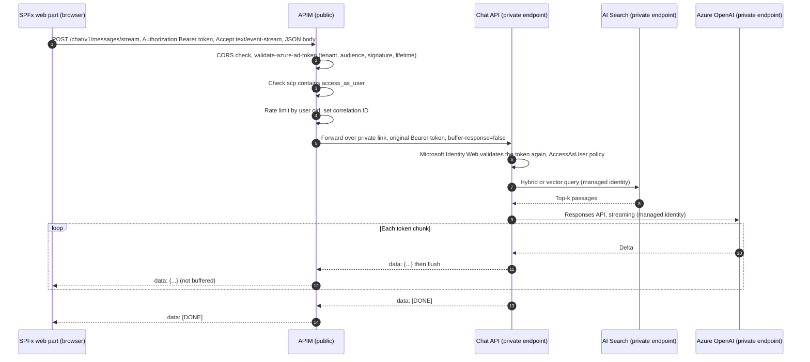

### 6.4 APIM inbound policy decisions

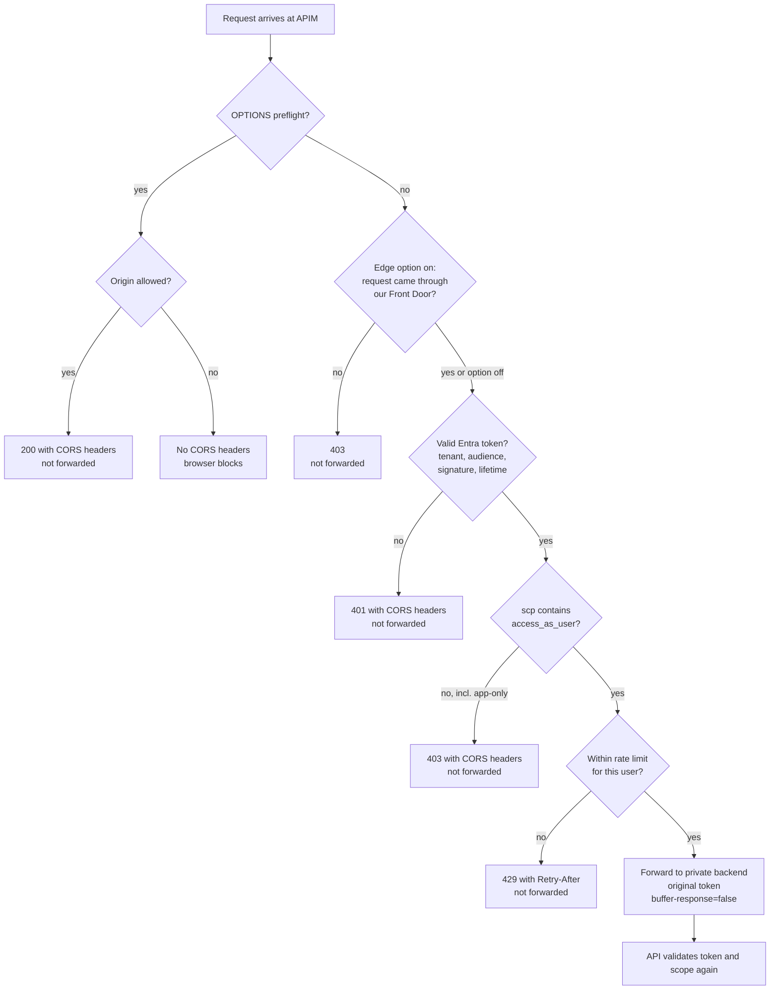

Errors generated by APIM must include CORS headers for allowed origins. Otherwise the browser hides the status code from the web part, and the user sees a generic network error instead of "please sign in again" **[verify]**.

### 6.5 Rejected requests

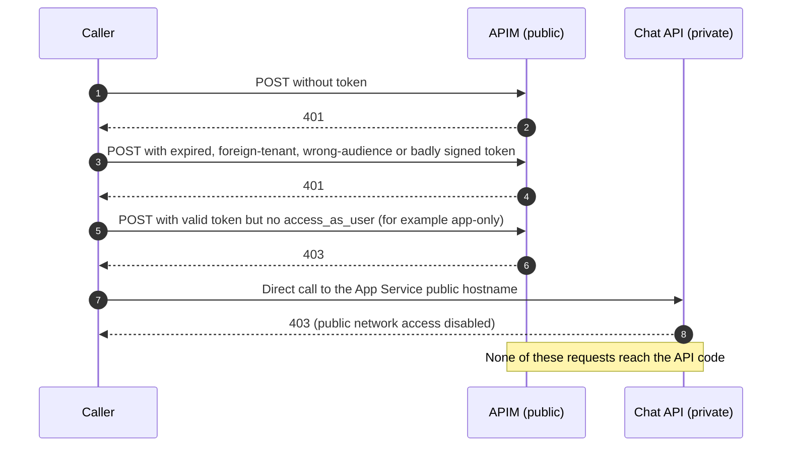

### 6.6 Cancellation

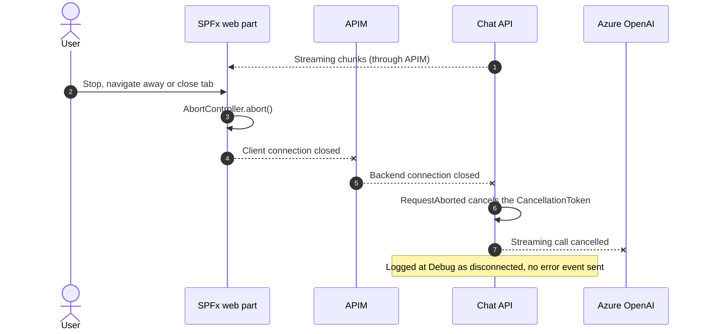

The PoC must confirm whether APIM closes the backend connection as soon as the client disconnects **[verify]**. If it does not, the API keeps consuming model tokens until the answer is complete.

### 6.7 Downstream private connectivity and DNS resolution

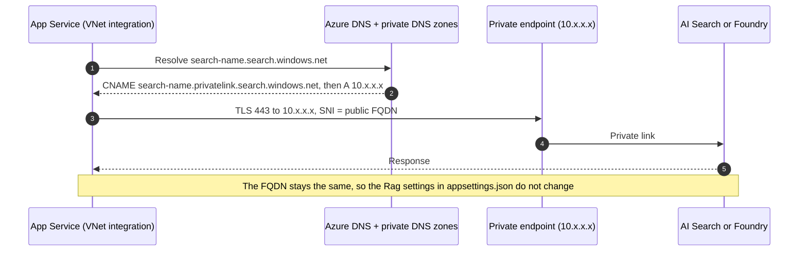

APIM resolves the App Service hostname the same way through `privatelink.azurewebsites.net`. The backend URL in APIM stays `https://<app-name>.azurewebsites.net`, so the default App Service certificate still matches.

## 7. Optional edge protection (Front Door + WAF)

APIM has no built-in Web Application Firewall. The board should choose between two options:

| | Option A: APIM directly on the internet | Option B: Azure Front Door (Premium) + WAF in front of APIM |
|---|---|---|
| Layer 7 protection | APIM policies only (JWT, rate limit, size limits) | WAF managed rule set and bot protection before APIM; APIM policies still apply |
| DDoS | Azure platform DDoS protection (infrastructure level) | Front Door's global edge absorbs volumetric attacks |
| Bypass prevention | Not applicable | APIM must accept only traffic from our Front Door profile. Check the `X-Azure-FDID` header, and filter on the `AzureFrontDoor.Backend` service tag, or use Private Link from Front Door to APIM if the tier supports it **[verify]**. |
| SSE | Supported by APIM (classic and v2 tiers, not Consumption) | Front Door's behaviour with long-lived SSE responses and its origin response timeout must be tested **[verify]** |
| Complexity | Lower | Higher: extra hop, extra TLS certificate, extra logs |
| Attack surface | `*.azure-api.net` (or a custom domain) is public | The Front Door endpoint is public. APIM is effectively locked to Front Door. |

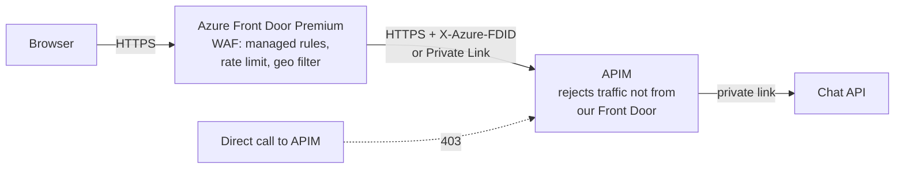

The WAF inspects request bodies. Make sure managed rules do not block normal chat prompts, such as text that looks like SQL or script. Run the WAF in detection mode first.

## 8. APIM configuration (illustrative)

This policy is illustrative and must be validated in the PoC. Named values (`{{...}}`) hold tenant-specific identifiers. They are not secrets.

```xml
<policies>
  <inbound>
    <base />
    <cors allow-credentials="false" terminate-unmatched-request="true">
      <allowed-origins>
        <origin>https://<tenant>.sharepoint.com</origin>
        <origin>https://teams.microsoft.com</origin>
        <!-- add the real Teams origins observed per client; see README section 7.3 -->
      </allowed-origins>
      <allowed-methods><method>POST</method><method>OPTIONS</method></allowed-methods>
      <allowed-headers><header>authorization</header><header>content-type</header><header>accept</header></allowed-headers>
    </cors>

    <!-- Option B only: reject traffic that did not come through our Front Door -->
    <!--
    <check-header name="X-Azure-FDID" failed-check-httpcode="403" failed-check-error-message="Forbidden" ignore-case="true">
      <value>{{front-door-id}}</value>
    </check-header>
    -->

    <validate-azure-ad-token tenant-id="{{tenant-id}}"
                             header-name="Authorization"
                             failed-validation-httpcode="401"
                             failed-validation-error-message="Unauthorized"
                             output-token-variable-name="jwt">
      <audiences>
        <audience>{{api-client-id}}</audience>
      </audiences>
    </validate-azure-ad-token>

    <choose>
      <when condition="@(!((Jwt)context.Variables[&quot;jwt&quot;]).Claims.GetValueOrDefault(&quot;scp&quot;, &quot;&quot;).Split(' ').Contains(&quot;access_as_user&quot;))">
        <return-response>
          <set-status code="403" reason="Forbidden" />
        </return-response>
      </when>
    </choose>

    <rate-limit-by-key calls="{{chat-calls-per-minute}}" renewal-period="60"
                       counter-key="@(((Jwt)context.Variables[&quot;jwt&quot;]).Claims.GetValueOrDefault(&quot;oid&quot;, &quot;anonymous&quot;))" />

    <set-header name="X-Correlation-ID" exists-action="skip">
      <value>@(context.RequestId.ToString())</value>
    </set-header>
    <set-backend-service backend-id="chat-api-private" />
  </inbound>

  <backend>
    <forward-request buffer-response="false" timeout="{{chat-timeout-seconds}}" />
  </backend>

  <outbound>
    <base />
  </outbound>

  <on-error>
    <base />
  </on-error>
</policies>
```

Gateway settings for this API:

| Setting | Value | Reason |
|---|---|---|
| Subscription required | **Off** | A subscription key in browser code is not secret (S4). Identity comes from the JWT. |
| Response caching | Off | Responses are personal and streamed. |
| `validate-content` | Not used on this route | Conflicts with streaming, according to the APIM SSE guidance. |
| Diagnostic logs | Headers and bodies **not** logged; `Authorization` never logged | S6 and SSE guidance |
| Backend | `https://<app-name>.azurewebsites.net`, certificate chain and name validation on | S8 |
| Rate limit | Per user (`oid`). Values set after the load test. | S7. Policy availability per tier **[verify]** |
| Request size | Limit the body size for this route | Limits abuse of model tokens |
| API path | `/chat/v1/messages/stream` → backend `/api/messages/stream` | F4: stable, versioned gateway contract |

## 9. Logging, monitoring and data handling

| Source | What is logged | Not logged | Destination |
|---|---|---|---|
| Front Door / WAF (option B) | Client IP, rule matches, status | Bodies | Log Analytics |
| APIM | Request ID, operation, status, latency, caller `oid` (pseudonymised if the privacy policy requires it) | `Authorization` header, request and response bodies | Log Analytics / Application Insights |
| Chat API | Trace ID, errors, dependency calls | Prompts, answers, tokens. IdentityModel PII off outside Development. | Application Insights |
| AI Search, Foundry | Platform metrics and diagnostic logs | Content, per service configuration | Log Analytics |

Alerts to define:

- Spikes in APIM 401/403 responses (credential stuffing or misconfiguration).
- APIM 429 responses per user (abuse, or a limit that is too low).
- Backend 5xx and backend connection failures (private path or DNS broken).
- Changes to public network access or private endpoint connections on App Service, Search or Foundry (Azure Policy and Activity Log).
- WAF blocks (option B).

**Correlation:** APIM sets `X-Correlation-ID`. The API already returns a trace reference in its error event. Align both so that support can follow one ID from browser to model call (N3). **[verify]** how the API picks up the APIM header.

**Data in transit:** user prompts, retrieved passages and model answers pass through APIM and the API in memory. This design does not store them. Whether Azure OpenAI abuse monitoring stores prompts depends on the subscription's configuration and is a separate privacy decision.

## 10. Threat model (STRIDE)

| # | Threat | Asset / hop | Mitigation | Residual risk |
|---|---|---|---|---|
| T1 | **Spoofing:** a caller without a token or with a forged token | APIM, API | `validate-azure-ad-token` at APIM, `Microsoft.Identity.Web` at the API, signing keys from Entra metadata | Low |
| T2 | **Spoofing:** a token for another API or tenant, or an app-only token | APIM, API | Fixed tenant, exact audience, separate `scp` check at both layers | Low |
| T3 | **Spoofing:** a stolen user token replayed from another device | APIM | Short token lifetime, Conditional Access at sign-in, rate limit. Token binding is not available for this flow. | Medium. Accepted; same as today. |
| T4 | **Tampering / bypass:** calling the API directly and skipping APIM | API | Public network access disabled, private endpoint, NSG allows only the APIM subnet, the API validates the token itself | Low |
| T5 | **Bypass:** calling APIM directly and skipping Front Door (option B) | APIM | `X-Azure-FDID` check plus service tag filter, or Private Link origin | Low, after verification |
| T6 | **Repudiation:** a user denies having sent a prompt | Logs | `oid` and request ID logged at APIM and API, without content | Low. Content is not kept by design. |
| T7 | **Information disclosure:** tokens or prompts in logs | APIM, API logs | No header or body logging; PII logging blocked outside Development | Low |
| T8 | **Information disclosure:** a user retrieves index content they should not see | AI Search | None at present; the managed identity can read the whole index ([section 5.4](#54-data-authorization-in-the-rag-step)) | **Depends on index content. Board decision.** |
| T9 | **Information disclosure:** verbose errors | API | Generic error message with a trace reference | Low |
| T10 | **Information disclosure:** data exfiltration from Search or Foundry over the internet | Search, Foundry | Public network access disabled, local authentication disabled, RBAC | Low |
| T11 | **Denial of service:** volumetric attack on the public endpoint | APIM | Platform DDoS protection; option B adds the Front Door edge and WAF | Medium without option B |
| T12 | **Denial of wallet:** an authenticated user floods expensive model calls | APIM, Foundry | Per-user rate limit, request size limit, Foundry quota, cost alerts | Medium. Tune after the load test. |
| T13 | **Denial of service:** long-lived SSE connections exhaust gateway capacity | APIM | Forward timeout, concurrency limits, capacity monitoring | Medium. Sizing in the PoC. |
| T14 | **Elevation of privilege:** mock authentication enabled in production | API | `UseMockAuthentication` and `UseMockResponses` must be `false`. Enforce through deployment configuration and a startup guard. | **Medium until a guard exists.** See [section 11](#11-required-changes). |
| T15 | **Elevation of privilege:** an over-permissive SPFx API approval | Tenant | Approve only `access_as_user` for the API. Review SharePoint API access requests regularly. Any SPFx solution in the tenant can request a token for an approved permission. | Medium. Accepted platform behaviour; APIM and the API rely on scope, not on the calling solution. |
| T16 | **Prompt injection** through user input or indexed content | API, model | Out of scope for the ingress design. Covered by content safety and prompt design. | Unchanged |

## 11. Required changes

| # | Change | Component | Type |
|---|---|---|---|
| 1 | Deploy APIM in a tier that supports outbound VNet integration and SSE (not Consumption). The tier is a board decision. | Azure | Infrastructure |
| 2 | Create the VNet, subnets, NSGs, private endpoints and private DNS zones shown in [section 4.2](#42-network-view). | Azure | Infrastructure |
| 3 | Enable App Service outbound VNet integration. Add a private endpoint. **Disable public network access** once the private path is verified. | Azure | Infrastructure |
| 4 | Add private endpoints for AI Search and Foundry. Create the Search shared private link to Foundry and approve it. Disable public network access and local (key) authentication on both. | Azure | Infrastructure |
| 5 | Configure the APIM API, backend and policy as in [section 8](#8-apim-configuration-illustrative). | APIM | Configuration |
| 6 | Point `apiUrl` to the APIM gateway URL. Keep `apiResource` unchanged. **Update every placed web part instance**, because saved properties override manifest defaults. | SPFx | Configuration |
| 7 | Keep the API's JWT validation and CORS. Keep the API audience unchanged. | API | None |
| 8 | Add a startup guard that refuses to start when `UseMockAuthentication` or `UseMockResponses` is `true` outside Development (T14). | API | Small code change |
| 9 | If PoC test 10 fails: add a periodic SSE heartbeat (comment line) in [MessagesController.cs](../../api/Controllers/MessagesController.cs) to stay below intermediary idle limits. | API | Conditional code change |
| 10 | Move deployments to a path that can reach the private App Service. When public access is disabled, the SCM/Kudu endpoint becomes private as well. Use a self-hosted or VNet-connected build agent, or a deployment method that does not need SCM access **[verify]**. | CI/CD | Pipeline |
| 11 | Option B only: deploy Front Door Premium with WAF and lock APIM to it. | Azure | Infrastructure |
| 12 | Assign Azure Policy definitions that deny public network access on App Service, Search and Foundry in this scope. | Governance | Policy |

## 12. Validation plan and acceptance criteria

The PoC must pass these tests from each supported client: SharePoint in a browser, Teams desktop, Teams web, Teams mobile (iOS and Android); managed and unmanaged devices; on and off the corporate network.

| # | Test | Expected result |
|---|---|---|
| 1 | `OPTIONS` from an allowed origin, no token | 200 with correct CORS headers; not forwarded |
| 2 | `OPTIONS` from a disallowed origin | No `Access-Control-Allow-Origin` header |
| 3 | `POST` without a token | APIM 401 with CORS headers; nothing in API logs |
| 4 | `POST` with a valid token without `access_as_user`, including an app-only token | APIM 403 with CORS headers; nothing in API logs |
| 5 | `POST` with an expired, badly signed, foreign-tenant or wrong-audience token | APIM 401; nothing in API logs |
| 6 | Valid token and body | 200 `text/event-stream` |
| 7 | Time to first chunk through APIM | Comparable to a direct call; not after the full answer |
| 8 | Chunks arrive one by one through every hop (and through Front Door in option B) | Passes |
| 9 | Abort `fetch` during streaming | API logs the disconnect; the model call stops |
| 10 | Stream with an idle gap longer than 4 minutes | Survives, or fails predictably and is documented |
| 11 | Direct call from the internet to App Service, Search and Foundry | 403 or no route |
| 12 | APIM reaches the API only through the private endpoint | DNS returns a private IP inside the VNet; public access off |
| 13 | The API receives the original bearer token and enforces audience and scope on its own (disable the APIM checks temporarily in a test environment) | API returns 401/403 |
| 14 | Option B: direct call to APIM, bypassing Front Door | 403 |
| 15 | Existing placed web parts after the `apiUrl` change | Work, or are reconfigured |
| 16 | Logs contain no `Authorization` header, prompts or answers | Passes |
| 17 | Rate limit for a single user | 429 after the configured limit; other users not affected |
| 18 | Load test with the expected number of concurrent streams | Within agreed latency and error budgets; APIM capacity recorded |

## 13. Decisions requested from the board

| # | Decision | Options | Recommendation |
|---|---|---|---|
| D1 | Is a public, authenticated gateway acceptable for this workload? | Yes (pattern 3.2) / No (pattern 3.1, private ingress) | **Yes.** Pattern 3.1 excludes unmanaged, mobile and off-network devices unless VPN or Entra Private Access is rolled out. |
| D2 | APIM tier | Standard v2 (outbound VNet integration) / Premium v2 / classic Premium (VNet injection) | Decide after the PoC, based on SSE behaviour, capacity, availability zones and policy support. |
| D3 | Edge protection | Option A (APIM directly) / Option B (Front Door + WAF) | Option B if the security policy requires a WAF in front of every internet-facing endpoint. Otherwise option A, with the per-user rate limit. |
| D4 | Per-user data authorization in Search (T8) | Accept: index content is open to all authorized users / Require: security trimming as a follow-up | Depends on the classification of the index content. |
| D5 | Conditional Access for the SPFx token | Rely on the SharePoint/Teams sign-in policy / Add a policy targeting the API app | Align with the existing Conditional Access baseline. |
| D6 | Logging of caller identity | Log `oid` as is / pseudonymise | Follow the privacy policy. |

## 14. Alternatives considered

| Alternative | Why not chosen |
|---|---|
| **3.1 Private APIM ingress** (no public endpoint) | Every client needs private DNS and a network route (VPN, ExpressRoute, Entra Private Access). Teams mobile and unmanaged devices are not covered, or need extra licences and agents. Chrome's Local Network Access permission may block or prompt inside SharePoint/Teams frames **[verify]**. |
| **Keep the API public, without APIM** | No uniform entry point for future APIs, no gateway-level rate limiting, and the workload origin stays exposed. Meets S2 but not S1. |
| **App Service access restrictions instead of a private endpoint** | Possible, but the origin keeps a public IP. A private endpoint with public access disabled gives a clearer answer to S1. |
| **APIM uses its own managed identity to call the API** | The API loses the user's identity and must trust APIM blindly. Rejected in favour of forwarding the user's token ([section 5.3](#53-why-apim-forwards-the-users-token-rather-than-its-own)). |
| **APIM subscription keys for clients** | A key in browser code is not secret (S4). It adds nothing on top of the JWT. |

## 15. Risks and open questions

| Risk / question | Impact | Mitigation |
|---|---|---|
| SSE over a `POST` with a JSON body through APIM is not explicitly documented **[verify]** | F2 fails | PoC tests 6 to 10 before any production change |
| APIM may not cancel the backend call when the client disconnects **[verify]** | Model cost continues after the user cancels | PoC test 9; reduce the forward timeout if needed |
| Idle timeout during long model "thinking" gaps | The stream breaks | Heartbeat (change 9) |
| Front Door behaviour with long SSE responses **[verify]** | Option B breaks streaming | Test before choosing option B |
| The deployment pipeline loses access to App Service when public access is off | Releases blocked | Change 10 before switching off public access |
| Placed web parts keep the old `apiUrl` | Users call the old endpoint, which will start failing | Inventory placed instances and update them before switching off public access |
| Real `Origin` values differ per Teams client | CORS failures in some clients | Capture `Origin` per client, as described in README section 7.3 |

## 16. Rollout outline

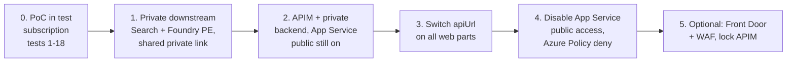

Each step can be rolled back on its own up to step 4. After step 4, rolling back means re-enabling public network access on App Service and pointing `apiUrl` back.

## 17. References

- [Research: APIM with JWT validation and private backends](../research/private-backend-teams-sharepoint.md)
- APIM virtual network concepts: https://learn.microsoft.com/azure/api-management/virtual-network-concepts
- APIM `validate-azure-ad-token` policy: https://learn.microsoft.com/azure/api-management/validate-azure-ad-token-policy
- APIM Server-Sent Events: https://learn.microsoft.com/azure/api-management/how-to-server-sent-events
- App Service private endpoints: https://learn.microsoft.com/azure/app-service/overview-private-endpoint
- AI Search shared private link: https://learn.microsoft.com/azure/search/search-indexer-howto-access-private
- SPFx `AadTokenProvider`: https://learn.microsoft.com/sharepoint/dev/spfx/use-aadtokenprovider
- SPFx `AadHttpClient`: https://learn.microsoft.com/sharepoint/dev/spfx/use-aadhttpclient
- Teams manifest `validDomains`: https://learn.microsoft.com/microsoft-365/extensibility/schema/root#validdomains
